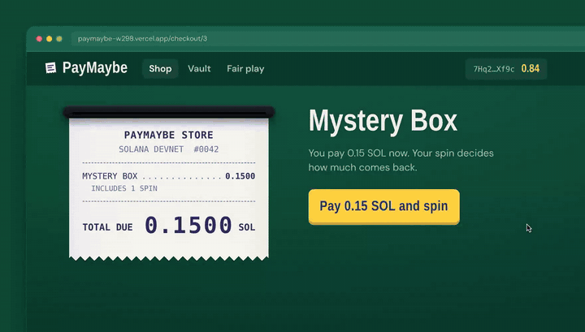

# PayMaybe — Buy Now, Pay Maybe

<p align="center"></p>

**The receipt is the slot machine.** Every checkout comes with one provably fair spin. Get 25%, half, or the whole thing back — plus a few Loyalty Shards every time (each sells back for 100 lamports) — and nobody else can see your spin while it runs.

> **MagicBlock Solana Blitz v10 (Nov 20–27, 2026) · Theme: Entertainment Finance**

- **Live App (Vercel):** [https://paymaybe-w298.vercel.app/](https://paymaybe-w298.vercel.app/)
- **Live Devnet Program ID:** [`BxHVeQ7R5LuPLnoL6ySbiDstPChxJcEgPjoHCWgo2erX`](https://explorer.solana.com/address/BxHVeQ7R5LuPLnoL6ySbiDstPChxJcEgPjoHCWgo2erX?cluster=devnet)
- **Live Funded StoreVault PDA (`store_v2`):** [`41ejxCLF7k88c5sH1qiM17Y5dRNbWmzFekim7ynDxN9r`](https://explorer.solana.com/address/41ejxCLF7k88c5sH1qiM17Y5dRNbWmzFekim7ynDxN9r?cluster=devnet) *(Authority: `FRFw8oAUQsHn3fZfis4dGcRhAXanoMo77TaKnm6cwLgf`)*
- **CI (Anchor 1.0.2 + Strict Frontend + Client):** [GitHub Actions CI Run (All Green)](https://github.com/tobeie/paymaybe/actions/runs/45308962241)
- **Live Devnet + MagicBlock TEE / VRF & Security Audit Probe:** [GitHub Actions Deploy & Probe Run #6 (All Green)](https://github.com/tobeie/paymaybe/actions/runs/45309013497)

---

## Try It in 60 Seconds

1. Open **[https://paymaybe-w298.vercel.app/](https://paymaybe-w298.vercel.app/)**.
2. Switch **Phantom** to **Solana Devnet** (Settings → Developer Settings → Testnet Mode) and grab free test SOL at [faucet.solana.com](https://faucet.solana.com) if needed.
3. Pick any hanging price tag from the shelf (e.g., **Ephemeral Espresso · 0.02 SOL**), click **Buy and spin**, approve the checkout transaction, sign the private session prompt, and watch the thermal receipt print each chain step, spin the `YOU PAY` odometer reel, and slam the rubber stamp.
4. Click **Compare with a stranger's view** to inspect the live side-by-side carbon copy (`Your copy` via TEE JWT vs `A stranger's copy` returning `null`), open **Vault** (`/vault`) to claim cashback or sell shards anytime, and open **Fair play** (`/fair`) to see your real rolls pinned on the `0–9,999` strip.

---

## 1. The Concept

Built for MagicBlock's **Entertainment Finance** theme, **PayMaybe** is a drop-in gamified checkout storefront on Solana where every real purchase triggers a private, sub-second, provably fair rebate spin inside a **MagicBlock Private Ephemeral Rollup (TEE) + Permission Program + MagicBlock VRF**:

1. **Pay Once on Solana L1 (`init_buyer` + `deposit_checkout` + `delegate_buyer`):**  
   The buyer pays a fixed on-chain catalog price into an **undelegated** Solana L1 `StoreVault` PDA seeded with cashback & shard-buyback liquidity, pre-funds `BuyerAccount` with `EphemeralPermission` rent, and delegates only their `BuyerAccount` PDA to the **MagicBlock TEE Validator (`MTEWGuqxUpYZGFJQcp8tLN7x5v9BSeoFHYWQQ3n3xzo`)**.
2. **Confidential TEE Permission + Gasless VRF Spin (`enable_privacy` + `request_spin` → `callback_resolve_spin`):**  
   Inside MagicBlock TEE (`https://devnet-tee.magicblock.app`), `enable_privacy` invokes the real **MagicBlock Permission Program (`ACLseoPoyC3cBqoUtkbjZ4aDrkurZW86v19pXz2XQnp1`)** via `CreateEphemeralPermissionCpi` (`is_private: true`, buyer-only read/logs). Unauthenticated stranger reads against the TEE return `{ "value": null }` while the authenticated buyer (via `getAuthToken` JWT) reads their live 136-byte state. MagicBlock VRF (`DEFAULT_EPHEMERAL_QUEUE`) then executes our spoof-proof `#[vrf_callback]` in **5 TEE slots (~250ms)** for **3,479 CU** and **0 gas**, rolling an unbiased 64-bit tier against `StoreVault.tier_odds_bps` and awarding instant SOL cashback (0%, 25%, 50%, or **100% FREE**) plus guaranteed **Loyalty Shards**.
3. **Instant L1 Settlement, "Sell Anytime" Liquidity & Merchant Withdraw (`commit_and_undelegate_buyer` → `claim_or_sell_shards` / `withdraw_merchant_funds`):**  
   `commit_and_undelegate_buyer` invokes `CloseEphemeralPermissionCpi` (refunding ephemeral permission rent back to `BuyerAccount`) and calls `MagicIntentBundleBuilder::commit_and_undelegate` (confirmed on L1 via `GetCommitmentSignature` in `@magicblock-labs/ephemeral-rollups-sdk@0.18.0`). Buyers can immediately **Claim SOL Cashback** or **Sell Loyalty Shards Anytime** back to the L1 `StoreVault` reserve, while merchants can withdraw earned revenue via `withdraw_merchant_funds` without ever touching protected shard reserves or active buyer escrows.

> **Zero fake simulation:** No `Math.random()`, no mocked outcomes, no fake privacy checks, no hardcoded tx hashes. Every checkout, Permission Program CPI, dual-read TEE privacy proof, VRF roll, commit, and SOL payout is a live Solana Devnet + MagicBlock TEE transaction.

---

## 2. Why MagicBlock Is Load-Bearing

*If you ask: "Couldn't you just do this with Switchboard VRF on Solana L1?" — No:*

| Requirement | Solana L1 Only | PayMaybe on MagicBlock TEE + VRF |
|---|---|---|
| **Checkout Spin UX** | 5–15s wait for external L1 oracle + extra tx fees | **Sub-second (~250ms), 0 gas** inside MagicBlock TEE |
| **Consumer Financial Privacy** | Every purchase, spin attempt & win broadcast publicly on L1 | **Hardware Intel TDX TEE + Permission Program (`ACLseoPoy...`)**: live dual-read proof verifies strangers get `null` while the signed buyer reads their live state via `getAuthToken` JWT |
| **Custody & Instant Exit** | All state & funds coupled on one layer | Real SOL stays anchored in **undelegated L1 `StoreVault`**; only `BuyerAccount` delegates and commits settlement back for instant "Sell Anytime" payouts |

---

## 3. Architecture, Odds & Security Invariants

```text
  Buyer (Phantom on Devnet)          Solana L1 (Custody)              MagicBlock TEE (Intel TDX + VRF)
  ─────────────────────────          ───────────────────              ────────────────────────────────
  1. Click "Buy and spin" ─────────► StoreVault PDA (undelegated)
     (init_buyer + deposit_checkout   • Enforces fixed catalog price
      + delegate_buyer)               • Locks active_escrow + shard reserve
                                      • SpinState: Idle -> Paid
                                      └─ delegates BuyerAccount ──────► BuyerAccount PDA on TEE
                                                                        2. getAuthToken (Ed25519 JWT)
                                                                        3. enable_privacy (0 gas)
                                                                           └─► Permission Program CPI
                                                                               (ACLseoPoy...: buyer-only)
                                                                        4. Dual-Read Privacy Proof:
                                                                           • Stranger (no token) -> null
                                                                           • Owner (JWT) -> 136 bytes
                                                                        5. request_spin (Paid -> PendingVrf)
                                                                           └─► MagicBlock VRF Oracle
                                                                        6. #[vrf_callback] callback_resolve_spin
                                                                           • Unbiased u64 % 10_000 roll
                                                                           • PendingVrf -> Resolved, pending=0
                                                                           • 3,479 CU (compile-time VRF ID)
                                     L1 BuyerAccount restored ◄──────── 7. CloseEphemeralPermissionCpi +
                                     (confirmed via SDK 0.18.0             MagicIntentBundleBuilder
                                      GetCommitmentSignature)              ::commit_and_undelegate
  8. Claim SOL / Sell Shards ──────► claim_or_sell_shards (L1)
     Anytime                          • Instant SOL transfer from StoreVault
  9. Merchant Revenue ─────────────► withdraw_merchant_funds (L1)
                                      • Protects rent + shard_reserve + active_escrow
```

### Unbiased On-Chain Odds (`u64::from_le_bytes(randomness[0..8]) % 10_000`)

Evaluated directly against `StoreVault.tier_odds_bps` (`[7500, 1800, 600, 100]` by default; modulo bias $< 5.5 \times 10^{-16}$):

| VRF Roll (`roll_bps` in `0..9999`) | Exact Probability | Instant Cashback | Guaranteed Loyalty Shards |
|---:|---:|---:|---:|
| `9900–9999` | **1.00%** | **100% FREE (Full Refund)** | `10` Shards |
| `9300–9899` | **6.00%** | **50% Off** | `25` Shards |
| `7500–9299` | **18.00%** | **25% Off** | `50` Shards |
| `0–7499` | **75.00%** | `0%` | **`100` Shards** |

### On-Chain Security Invariants (Hardened & Live-Tested)
- **1 Payment = Strictly 1 Spin:** `SpinState` enforces `Idle -> Paid -> PendingVrf -> Resolved -> Idle`. `request_spin` requires `Paid` + `pending_amount > 0` and immediately flips to `PendingVrf`; `callback_resolve_spin` requires `PendingVrf` and immediately zeroes `pending_amount = 0`.
- **Stuck-Spin Resume & `cancel_spin` Safety Valve:** Pressing **Pay** automatically resumes any interrupted spin (`PendingVrf` or `Resolved`). If the VRF oracle never answers, undelegating back to L1 and calling `cancel_spin` refunds the exact escrowed payment (`Paid` / `PendingVrf` only — a `Resolved` spin can never be cancelled after seeing a losing roll).
- **Fixed Catalog Prices:** `deposit_checkout` enforces on-chain `ITEM_PRICES_LAMPORTS` (`[0.02, 0.05, 0.10, 0.15]` SOL) by `item_id` — eliminating 1-lamport shard farming — and replenishes `total_shard_reserve` (`+10,000` lamports) on every checkout.
- **Segregated Cashback, Escrow & Shard Reserves:** `claim_or_sell_shards`, `cancel_spin`, and `withdraw_merchant_funds` all preserve `rent_min + total_shard_reserve + other_active_escrow_lamports`, so neither cashback payouts nor merchant withdrawals can ever dip into shard buyback funds or in-flight escrows.
- **No Public Keypairs & Strict CI:** Zero keypair files tracked in git, `deploy-devnet.yml` hard-fails if `DEVNET_DEPLOYER_KEYPAIR` is missing, and strict `tsc --noEmit` + `next build` (no `ignoreBuildErrors`) runs on every push.

---

## 4. Verified Live Devnet + MagicBlock TEE & Security Audit Proofs

Every instruction and negative exploit test in [milestone0-probe.ts](client/src/milestone0-probe.ts) ran live on Solana Devnet + `https://devnet-tee.magicblock.app` in **[Run #6 (`45309013497`)](https://github.com/tobeie/paymaybe/actions/runs/45309013497)**:

| Step | Layer | Action / Security Proof | Verified Live On-Chain Transaction |
|---|---|---|---|
| **1** | Solana Devnet | `init_store` (`store_v2`, 0.10 SOL seed, `[7500, 1800, 600, 100]`) | [`2cMvfLWR...`](https://explorer.solana.com/tx/2cMvfLWRmqhV7sXaGLRqAauKCGTzkTZXkUixcYCzYZeJW1bUVk4MTkWGtggiHXMbVLehPxpCpTUNMzm8ofYwrpeZ?cluster=devnet) |
| **2** | Solana Devnet | `init_buyer` (`buyer_v2` + pre-funds `EphemeralPermission` rent) | [`5oPBn6Wk...`](https://explorer.solana.com/tx/5oPBn6WkWzuLiYyLrScokT4pumXWXUA9MDQ7fMKBZuycAj5s7cQEWxEg7SSEo7FG56ZT2iRx8FEdEWVYx8TUeCCA?cluster=devnet) |
| **3** | Solana Devnet | `deposit_checkout` (1-lamport exploit rejected; fixed `0.02 SOL` escrowed) | [`66DEXy2a...`](https://explorer.solana.com/tx/66DEXy2aYbQ275ErevNZWhdFigSJBRv5Qa9EuFziccNUhEBhEYB8Zs2ihFQRqyZeH9ASgfQ7FTNNSTA2PZsc12R9?cluster=devnet) |
| **4** | Solana Devnet | `delegate_buyer` → `MTEWGuqx...` (MagicBlock TEE Validator) | [`371cfn5R...`](https://explorer.solana.com/tx/371cfn5RemtiXmEVQb9Gbbs8MfYbXSXCgKqTHccSwXkLBSFwpipRXXfv7ka2JXCreMABY9KrJJRTD8UUixfyGUG3?cluster=devnet) |
| **5** | MagicBlock TEE | `enable_privacy` → **Real `ACLseoPoy...` Permission Program CPI** (`6,151 CU`) + Dual-Read Proof (`Stranger: null`, `Owner JWT: 136 bytes`) | [`2qCXAkQr...`](https://explorer.solana.com/tx/2qCXAkQrMTTeEYdma2hmdgoadUDPNaT6oJ7io2bd3vDt7XRR7xPXbbas4RF4nj5BYpNPB2bhUN6fHhymWSGdhXYd?cluster=custom&customUrl=https%3A%2F%2Fdevnet-tee.magicblock.app) |
| **6** | MagicBlock TEE | `request_spin` (`Paid -> PendingVrf`, VRF on `DEFAULT_EPHEMERAL_QUEUE`) | [`3hzHjWro...`](https://explorer.solana.com/tx/3hzHjWrob42URYrWTrsrgLRWFESJN7WTNPyvRaBRyhDxf4UqxLQoiQh3Xn5gXbQmbTrbXUVchGgE42pFpNS97LRV?cluster=custom&customUrl=https%3A%2F%2Fdevnet-tee.magicblock.app) |
| **7** | MagicBlock TEE | `#[vrf_callback] callback_resolve_spin` *(+5 slots, **3,479 CU**, roll `8459/9999` → **25% Off = 0.005 SOL + 50 Shards**, `pending=0`)* | [`36QbTVqt...`](https://explorer.solana.com/tx/36QbTVqtbSCVW7oYLmo7qeBycj1ks8GNhNSgzWBBDaoKqm2SXwudYP42UXijzJw51MjFpEhFgF195AjK1U7BUGGr?cluster=custom&customUrl=https%3A%2F%2Fdevnet-tee.magicblock.app) |
| **8** | MagicBlock TEE | **Negative Exploit Proof:** 2nd `request_spin` rejected on-chain (`Error 6005: NoPaidCheckout`) | [`3MVeSc2v...`](https://explorer.solana.com/tx/3MVeSc2vYz6RY9H1uJWQvaeRbjq3wwjpw8Ct3X2BDMptTUwZqbU2zfyZkSS3UiepdnJaTxw3YVaM86o38i9pX4US?cluster=custom&customUrl=https%3A%2F%2Fdevnet-tee.magicblock.app) |
| **9** | MagicBlock TEE | `commit_and_undelegate_buyer` (`CloseEphemeralPermissionCpi` + undelegate) | [`3XFE9V1S...`](https://explorer.solana.com/tx/3XFE9V1SPRvooUgmgXNzAE8NsasPE6CVJHzYnzdm7K7VuD1ZacVDrhNErJ4GMxT4gwSrJHMkc9udVgVEwmtKCo9C?cluster=custom&customUrl=https%3A%2F%2Fdevnet-tee.magicblock.app) |
| **10** | Solana Devnet | L1 Settlement Commit (`ProcessUndelegation` via SDK 0.18.0 `GetCommitmentSignature`) | [`5iUEeGDH...`](https://explorer.solana.com/tx/5iUEeGDH8MNa83n33r7VfqpGzfvLZYXWCuawF7R4PVQS92DTLeGnqnRgChX1wEqv7dQAovBQbkRqHpT66Vds1yv8?cluster=devnet) |
| **11** | Solana Devnet | `claim_or_sell_shards` (Paid `5,001,000` lamports = 0.005 SOL cashback + 10 sold shards) | [`5N7wbEAJ...`](https://explorer.solana.com/tx/5N7wbEAJwLkCcCai2FLgmV3WtBAHcTWHSnN6BwH74ffv7eBZm5n42e6Stn9Z2Y8UFtVEJftctmq2RWtftMjRrrYo?cluster=devnet) |
| **12** | Solana Devnet | `withdraw_merchant_funds` (Reserve-rug rejected; withdrew `0.001 SOL` safely) | [`2Ctq7rRv...`](https://explorer.solana.com/tx/2Ctq7rRv8npuebbWsrZcsocQGHZiXxjr2k8qz2eTmQ4tKEWEczFpMHRQciKNq4xMmmHjCVmHhz7F4JfT8iu5yDTw?cluster=devnet) |

---

## 5. Engineering Highlight (Note for MagicBlock Judges)

### Fixing a 271k-CU Runtime Exhaustion Bug in `ephemeral-rollups-sdk v0.18.0`'s `#[vrf_callback]` Macro

During live Devnet testing, the real MagicBlock VRF oracle (`Vrf1RNUjXmQGjmQrQLvJHs9SNkvDJEsRVFPkfSQUwGz`) invoked `CallbackResolveSpin` immediately, but our program consistently exhausted the entire compute budget before entering the handler body:

```text
Program BxHVeQ7R5LuPLnoL6ySbiDstPChxJcEgPjoHCWgo2erX invoke [2]
Program log: Instruction: CallbackResolveSpin
Program BxHVeQ7R5LuPLnoL6ySbiDstPChxJcEgPjoHCWgo2erX consumed 271190 of 271190 compute units
Program BxHVeQ7R5LuPLnoL6ySbiDstPChxJcEgPjoHCWgo2erX failed: Program failed to complete
```
*(Reproducible live ER tx: `2ZABc5NTEF4J2p7fb9obMunkWDdRDy71QZx3vHLVCvASQ4Zh9c29Lg78vxnFTD6HCLxP4Fsw5B2MmJzwgVJF6L3d`)*

**Root Cause (in `ephemeral-rollups-sdk v0.18.0`, `rust/vrf-macro/src/lib.rs`):**  
When `#[vrf_callback]` auto-injects `vrf_program_identity`, it generates:
```rust
#[account(address = Pubkey::new_from_array(::ephemeral_rollups_sdk::vrf::consts::scoped_vrf_identity_const(&crate::ID).0))]
pub vrf_program_identity: Signer<'info>,
```
Because Anchor expands `#[account(address = <expr>)]` into a regular runtime `if` check **without a `const` item**, Rust evaluates `scoped_vrf_identity_const(&crate::ID)` (pure-software Curve25519 PDA derivation) **at runtime inside SBF**, burning >271,000 CU on every VRF callback.

**Our Fix (`programs/pay-maybe/src/lib.rs`):**  
We promote the scoped VRF identity PDA to a true compile-time `pub const` while keeping `#[vrf_callback]` and the exact same scoped VRF signer constraint (`J5zck4juhYLVSGx7oyQ59t9RzM7vp2KLbNFWY7mFQLGp`):

```rust
pub const SCOPED_VRF_IDENTITY: Pubkey = Pubkey::new_from_array(
    ephemeral_rollups_sdk::vrf::consts::scoped_vrf_identity_const(&crate::ID).0,
);

#[vrf_callback]
#[derive(Accounts)]
pub struct CallbackResolveSpin<'info> {
    #[account(address = SCOPED_VRF_IDENTITY)]
    pub vrf_program_identity: Signer<'info>,
    #[account(mut)]
    pub buyer_account: Account<'info, BuyerAccount>,
}
```
This drops VRF callback execution from **>271,190 CU (out-of-compute crash)** to **3,479 CU total** on `devnet-tee.magicblock.app` (verified live in tx `36QbTVqt...`).

### Validator v2 + TEE Compatibility (`0.18.0` Pin)
- **Rust program:** `ephemeral-rollups-sdk = { version = "0.18", features = ["anchor", "access-control", "vrf"] }` on **Anchor `1.0.2` / Agave `3.1.9` / Rust `1.89`**.
- **Client & Frontend:** Exact-pinned `@magicblock-labs/ephemeral-rollups-sdk@0.18.0` running against `devnet-tee.magicblock.app` (`magicblock-core 1.1.1`) using `getAuthToken`, `EphemeralPermission` CPIs, and `GetCommitmentSignature`.

---

## 6. Repository Layout

```text
paymaybe/
├── docs/
│   └── paymaybe-hero.gif               # Checkout receipt demo GIF
├── programs/pay-maybe/
│   ├── Cargo.toml                      # Anchor 1.0.2 + ephemeral-rollups-sdk 0.18
│   └── src/lib.rs                      # Hardened StoreVault + BuyerAccount + TEE Permissions + VRF
├── client/
│   └── src/milestone0-probe.ts         # 12-step live Devnet + TEE Privacy + VRF & Security probe
├── frontend/
│   ├── src/app/page.tsx                # Shop: felt counter, hero receipt & hanging price tags
│   ├── src/app/checkout/[id]/page.tsx  # Live thermal receipt printer, odometer reel & TEE carbon copy
│   ├── src/app/vault/page.tsx          # Cashback slip, shard chip stack & receipt stubs
│   ├── src/app/fair/page.tsx           # Interactive 0–9,999 odds strip & live on-chain verification
│   ├── src/hooks/usePayMaybe.ts        # Real Devnet L1 + MagicBlock TEE JWT + VRF transaction hook
│   └── src/idl/pay_maybe.json          # Synced compiled Anchor 1.0.2 IDL
└── .github/workflows/
    ├── build.yml                       # CI: Strict TS/Next.js + Client + Anchor 1.0.2 / Agave 3.1.9 build
    └── deploy-devnet.yml               # Secure Devnet upgrade + IDL sync + live Milestone 0 probe
```

---

## 7. Run Locally

```bash
# Run frontend locally
cd frontend
npm install --legacy-peer-deps
npm run dev

# Run live Milestone 0 Devnet + MagicBlock TEE/VRF & Security probe
cd ../client
npm install --legacy-peer-deps
PROGRAM_ID=BxHVeQ7R5LuPLnoL6ySbiDstPChxJcEgPjoHCWgo2erX npm run probe
```

---

## 8. Design Notes & Scope

- **Daily rotating shelf (`Today's shelf`):** The four price tiers (`0.02`, `0.05`, `0.10`, `0.15` SOL) are enforced on-chain; each tier rotates deterministically through a 5-item pool at `00:00 UTC` so every visitor sees the same daily drop. Nothing physically ships.
- **Shards are small by design:** `1 shard = 100 lamports` (`100 shards = 0.00001 SOL`), sized as lightweight devnet loyalty chips that are always 100% backed by `StoreVault.total_shard_reserve`.
- **Stuck-spin recovery:** Half-finished spins resume automatically on **Pay**, or refund cleanly on Solana L1 via **Cancel this spin and refund** (`cancel_spin`).

---

## 9. Built With
- **Solana (Agave 3.1.9)** & **Anchor 1.0.2**
- **MagicBlock Private Ephemeral Rollups (Intel TDX TEE + Permission Program `ACLseoPoy...`)**
- **MagicBlock SDK (`ephemeral-rollups-sdk` 0.18 / `@magicblock-labs/ephemeral-rollups-sdk@0.18.0`)**
- **MagicBlock VRF (`Vrf1RNUjXmQGjmQrQLvJHs9SNkvDJEsRVFPkfSQUwGz`)**
- **Next.js 15 + React 19 + Tailwind CSS + Solana Wallet Adapter**
